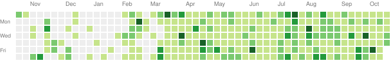

  

[+Pre-final+Year+Student+%40+MSRIT+Bengaluru;%F0%9F%92%BC+ML+Intern+%40+FlyRank;%F0%9F%8F%86+GSSoC%2726+Mentor+%7C+~135+Selected+Worldwide;%F0%9F%94%AC+Research+Intern+%40+IEEE+CS)](https://git.io/typing-svg)

 

 

 

<i>Just pushing some things that I build. 🚀</i>

  

<b>
<a href="#-current-roles">Roles</a> ·
<a href="#-tech-arsenal">Tech</a> ·
<a href="#-pinned-highlights">Pinned</a> ·
<a href="#-live-deployments--demos">Live Demos</a> ·
<a href="#-all-projects">Projects</a> ·
<a href="#-hackathons--achievements">Achievements</a> ·
<a href="#-github-stats--activity">Stats</a> ·
<a href="#-lets-connect">Connect</a>
</b>

 

<!-- ─── Current Roles ──────────────────────────────────────────────────── -->

  

| 💼 Role | 🏢 Organization | 🌟 Highlight |
|:---:|:---:|:---:|
| **ML Intern** | **FlyRank** | Learning to build production-grade ML pipelines |
| **GSSoC'26 Mentor** | **GirlScript Summer of Code** | Among ~135 mentors selected worldwide |
| **Research Intern** | **IEEE Computer Society** | Building VectorDrug Repurpose |

 

LeetCode • GitHub • Portfolio • Competitive Programming

 

<!-- ─── Tech Arsenal ─────────────────────────────────────────────────── -->

  

### ⚡ Languages & Frameworks

### 🤖 AI · ML · Data Science

### 🧠 LLM · Agentic AI

  
  
  
  
  
  
  
  
  
  
  
  

### ☁️ Cloud · DevOps

  
  
  
  

### 🗄️ Databases

  
  
  

### 🛠️ Developer Tools

 

<!-- ─── Pinned Repos ─────────────────────────────────────────────────── -->

  

&nbsp;

&nbsp;

 

<!-- ─── Live Deployments ─────────────────────────────────────────────── -->

  

<table>
  <tr>
    <td valign="top" width="50%">
      <h4>🟢 <b>Deployed Projects</b></h4>
      <ul>
        <li><b>🚔 Project Falcon</b> &nbsp; <a href="https://auth-60079106947.development.catalystserverless.in/app/index.html#/login">🔗 Live Deployment</a> <i>AI-powered crime analytics platform with role-based dashboards, hotspot visualization, criminal network analysis, predictive insights & intelligent investigation support.</i>  </li>
        <li><b>🚀 Project Astraeus</b> &nbsp; <a href="https://astraeus-frontend.onrender.com/">🔗 Hands-on Demo</a> <i>AI-powered Mission Control with digital-twin simulation, real-time monitoring & intelligent decision support.</i>  </li>
        <li><b>❤️ DonorConnect</b> &nbsp; <a href="https://github.com/MUKUL-PRASAD-SIGH/DonorConnectT">🔗 View Repository</a> <i>ML & DL powered real-time blood donor-recipient intelligent matching platform.</i>  </li>
        <li><b>🧠 Amazon Nova Pulse</b> &nbsp; <a href="https://nova-pulse-gilt.vercel.app/">🔗 Live Deployment</a> <i>Voice-powered multi-agent news intelligence system using Amazon Nova AI.</i>  </li>
        <li><b>🌐 Portfolio Website</b> &nbsp; <a href="https://mukulprasad.netlify.app/">🔗 Visit Portfolio</a> <i>Personal portfolio showcasing AI, ML, and full-stack development projects & research work.</i>  </li>
        <li><b>📊 Hackathon Dashboard</b> &nbsp; <a href="https://hackersboard.netlify.app/">🔗 Hands-on Demo</a> <i>Real-time hackathon tracking, participant analysis & event management platform.</i></li>
      </ul>
    </td>
    <td valign="top" width="50%">
      <h4>🎬 <b>Demo Videos</b></h4>
      <ul>
        <li><b>⏳ Kairos</b> <a href="https://youtu.be/Q-XZVE3dy20">▶️ Watch Demo</a> <i>Full-duplex, interruptible real-time agent (Samsung Hackathon) that dynamically adapts when interrupted or corrected mid-task.</i></li>
        <li><b>🧠 NeuroSOC</b> <a href="https://youtu.be/eUf58W-rJoE">▶️ Watch Demo</a> <i>Neuromorphic AI Security Operations Center — real-time threat detection using SNN, LNN, and XGBoost ensemble in autonomous sandbox.</i></li>
        <li><b>⛏️ MOIL Manganese Copilot</b> <a href="https://www.youtube.com/watch?v=ZB8utg1Q0WM">▶️ Watch Demo</a> <i>SIH 2026: AI decision copilot transforming telemetry & mine signals into optimal next-shift recovery decisions.</i></li>
        <li><b>🔥 Jvalyx</b> <a href="https://www.youtube.com/watch?v=NJRoPRCKs64">▶️ Watch Demo</a> <i>SIH 2026: Space-based satellite thermal event triage and industrial fire consequence intelligence system.</i></li>
        <li><b>💳 Rebound</b> <a href="https://youtu.be/SxgtEXvsAV4">▶️ Watch Demo</a> <i>Autonomous AI revenue recovery & smart retry engine built for Razorpay AI Buildathon 2026.</i></li>
        <li><b>⚡ ContextOS</b> <a href="https://youtu.be/eOWGswfy5_E">▶️ Watch Demo</a> <i>Proactive Android AI agent that autonomously manages meetings, navigation, DND, reminders, and contextual workflows using adaptive on-device intelligence.</i></li>
        <li><b>🚀 Project Astraeus</b> <a href="https://youtu.be/HiNK79Ijav8">▶️ Watch Demo</a> <i>AI Mission Control — digital-twin simulation, real-time monitoring & intelligent decision support.</i></li>
        <li><b>📊 Hackathon Dashboard</b> <a href="https://youtu.be/o3bw84sPgDA">▶️ Watch Demo</a> <i>Real-time hackathon management dashboard for tracking teams, projects, and submissions seamlessly.</i></li>
        <li><b>🌾 KisaanMitra</b> <a href="https://youtu.be/S1hz6yakK4Y">▶️ Watch Demo</a> <i>Multi-Agent System for collective agricultural empowerment using AI, IoT & MAS architecture.</i></li>
        <li><b>❤️ DonorConnect</b> <a href="https://youtu.be/T3-CFJ__JWg">▶️ Watch Demo</a> <i>ML & DL powered real-time blood donor-recipient intelligent matching system.</i></li>
        <li><b>✂️ ClipBait</b> <a href="https://youtu.be/AgLqEC7HuPs">▶️ Watch Demo</a> <i>AI-powered smart clipboard for capturing and analyzing copied content intelligently.</i></li>
        <li><b>🧠 NovaPulse</b> <a href="https://youtu.be/KBmNAY7ayVg">▶️ Watch Demo</a> <i>Voice-powered multi-agent news intelligence system using Amazon Nova AI.</i></li>
      </ul>
    </td>
  </tr>
</table>

 

<!-- ─── All Projects ─────────────────────────────────────────────────── -->

  

 

| 🧠 Project | 🏷️ Category | 📄 Description |
| --- | :---: | --- |
| [Project Falcon 🦅](https://github.com/MUKUL-PRASAD-SIGH/Project-Falcon) |  | AI-powered public safety intelligence platform leveraging explainable RAG, geospatial crime hotspot detection, criminal network analysis, predictive analytics, anomaly detection, and multilingual AI assistants to support data-driven law enforcement investigations. |
| [NeuroSOC 🧠](https://github.com/MUKUL-PRASAD-SIGH/Project_NeuroSOC) |  | Neuromorphic AI SOC analyst system performing real-time threat detection using SNN, LNN, and XGBoost ensemble models with behavioral profiling, sandbox isolation, and feedback retraining. |
| [Kairos ⏳](https://github.com/MUKUL-PRASAD-SIGH/Samsung) |  | Full-duplex, interruptible real-time voice agent built for Samsung Hackathon — supports barge-in conversational turn-taking, mid-task corrections, and adaptive execution. |
| [Manganese Copilot ⛏️](https://github.com/MUKUL-PRASAD-SIGH/manganese) |  | SIH 2026: AI-driven decision copilot for MOIL mining operations, turning mine signals and sensor telemetry into optimal next-shift recovery decisions and yield intelligence. |
| [Jvalyx 🔥](https://github.com/MUKUL-PRASAD-SIGH/Jvalyx) |  | SIH 2026: Space-based industrial fire classification and consequence intelligence system triaging satellite thermal feeds to assess hazard zones and cascading risks. |
| [Project TCS 🏛️](https://github.com/MUKUL-PRASAD-SIGH/Project_TCS) |  | TCS Hackathon: Conversational municipal permit eligibility assistant powered by Google Gemini, reasoning across local civic regulations and licensing bylaws. |
| [Rebound 💳](https://github.com/MUKUL-PRASAD-SIGH/Rebound) |  | Razorpay AI Buildathon 2026: Autonomous AI revenue recovery engine orchestrating intelligent payment retry routing and customer churn mitigation. |
| [RegGraph-AI 🕸️](https://github.com/MUKUL-PRASAD-SIGH/RegGraph-AI) |  | AI-powered regulatory knowledge graph system for intelligent compliance mapping, automated regulation analysis, and graph-based reasoning over legal and policy documents. |
| [ContextOS ⚡](https://github.com/MUKUL-PRASAD-SIGH/ContextOS) |  | Intelligent Android background agent that proactively automates user workflows using contextual situation modeling, adaptive decision-making, autonomous action execution, Google API integrations, memory systems, and on-device AI-powered orchestration. |
| [GitHopper 🦘](https://github.com/MUKUL-PRASAD-SIGH/GITHOPPER) |  | Intelligent Git repository analysis platform that performs deep code scanning, technical debt detection, health scoring, and real-time monitoring using MCP and AI-powered synthesis for actionable developer insights. |
| [LLM Benchmark Game 🎮](https://github.com/MUKUL-PRASAD-SIGH/LLM_BENCHMARK_GAME) |  | Interactive AI benchmark platform that compares multiple LLMs through real-time game-based challenges and reasoning tasks to evaluate model intelligence, speed, and accuracy. |
| [PROJECT_ENTANGLEMENT 🚀](https://github.com/MUKUL-PRASAD-SIGH/PROJECT_ENTANGLEMENT) |  | SIH 2025: Project Astraeus — AI-powered Mission Control with digital twin simulation and predictive system monitoring. |
| [Hackathon-Dashboard 📊](https://github.com/MUKUL-PRASAD-SIGH/Hackathon-Dashboard) |  | Real-time hackathon management dashboard for event tracking, analytics, and participant intelligence. |
| [NovaPulse 🧠](https://github.com/MUKUL-PRASAD-SIGH/NovaPulse) |  | Voice-powered multi-agent news intelligence system using Amazon Nova AI for sentiment analysis, trend detection, and automated executive summaries. |
| [Clipbait ✂️](https://github.com/MUKUL-PRASAD-SIGH/Clipbait) |  | AI-powered smart clipboard system to capture, analyze, and understand copied content using ML & DL. |
| [DonorConnectT ❤️](https://github.com/MUKUL-PRASAD-SIGH/DonorConnectT) |  | ML & DL based real-time blood donor-recipient intelligent matching and healthcare support system. |
| [KisaanMitra 🌾](https://github.com/MUKUL-PRASAD-SIGH/KisaanMitra) |  | Multi-Agent System for collective agricultural intelligence — climate insights, autonomous irrigation, market intelligence, and financial inclusion for farmers. |
| [VAAYA-PROJECT ✈️](https://github.com/MUKUL-PRASAD-SIGH/VAAYA-PROJECT) |  | Smart travel platform blending Google Maps + Reels discovery + gamified exploration quests for travelers and local earners. |
| [VoOTEX 🎙️](https://github.com/MUKUL-PRASAD-SIGH/VoOTEX) |  | Voice-to-text transcription pipeline with speaker diarization, noise handling, and post-processing intelligence. |
| [X-FORECAST 📈](https://github.com/MUKUL-PRASAD-SIGH/X-FORECAST) |  | Advanced time-series forecasting models and dashboards for demand prediction, analytics, and trend intelligence. |
| [GlamGlow ✨](https://github.com/MUKUL-PRASAD-SIGH/GlamGlow) |  | ML-powered beauty product recommendation engine for personalized skincare and product discovery. |

> 🧠 **Machine Learning · Artificial Intelligence · Multi-Agent Systems · Data Intelligence Pipelines**
> Going beyond traditional software into *intelligent system engineering.*

 

<!-- ─── Hackathons & Achievements ───────────────────────────────────── -->

  

 

| 🏆 Competition / Hackathon | 🎯 Domain / Track | 🥇 Achievement |
| --- | :---: | --- |
| [🧠 CyreneAI Hackathon](https://github.com/MUKUL-PRASAD-SIGH/Project_NeuroSOC) |  | **🥈 1st Runner-Up**. Built **[NeuroSOC](https://github.com/MUKUL-PRASAD-SIGH/Project_NeuroSOC)** — Neuromorphic AI Security Operations Center integrating SNNs, Liquid Neural Networks (LNN), and XGBoost ensemble for real-time threat detection and autonomous sandbox containment. |
| [⛏️ Smart India Hackathon (SIH 2026)](https://github.com/MUKUL-PRASAD-SIGH/manganese) |  | **🏆 Semifinalist 2026 [Currently]** (Problem Statement 26009). Engineered **[MOIL Manganese Copilot](https://github.com/MUKUL-PRASAD-SIGH/manganese)** — an industrial operational copilot transforming telemetry and shift signals into optimal recovery decisions and yield forecasting. |
| [🔥 Smart India Hackathon (SIH 2026)](https://github.com/MUKUL-PRASAD-SIGH/Jvalyx) |  | **🏆 Semifinalist 2026 [Currently]**. Built **[Jvalyx](https://github.com/MUKUL-PRASAD-SIGH/Jvalyx)** — space-based industrial fire triage and consequence intelligence platform classifying orbital satellite thermal feeds to forecast risk tiers and blast boundaries. |
| [🏛️ TCS Hackathon](https://github.com/MUKUL-PRASAD-SIGH/Project_TCS) |  | **🎖️ Consolation Prize**. Developed **[Project TCS](https://github.com/MUKUL-PRASAD-SIGH/Project_TCS)** (Municipal Permit Assistant) — a Gemini-powered conversational assistant for checking municipal permit eligibility and reasoning through complex civic bylaws. |
| [🛢️ Wellbore Geology Prediction](https://github.com/MUKUL-PRASAD-SIGH/KAGGLE-Wellbore_Geology_Prediction) |  | Currently under **Top 150 teams** among 10,760 Entrants · 3,211 Participants · 2,967 Teams · 42,920 Submissions. Built an ML pipeline to predict subsurface geological formations from wellbore sensor data — combining feature engineering, XGBoost, and ensemble methods for high-accuracy stratigraphy classification. *(First international team participation, led by PyJa)* |
| [🏎️ F1 Race Result Classification](https://github.com/MUKUL-PRASAD-SIGH/KAGGLE-F1-race-result-classification) |  | Finished under **Top 25 teams** among 348 Entrants · 279 Participants · 145 Teams · 4,161 Submissions. Developed a classification model to predict Formula 1 race results using historical race data, driver stats, and circuit features — leveraging advanced ML techniques for accurate podium finish prediction. |
| [🚦 Flipkart Gridlock Hackathon 2.0](https://www.hackerearth.com/challenges/competitive/gridlock-hackathon-20/problems/) |  | Designed a system to provide valuable insights into passenger travel patterns, booking behavior, and trip cancellations — enabling data-driven demand prediction for the travel industry. Dataset: 77,299 training samples × 11 features across structured travel data. |

> 🏆 **Competing in Hackathons & ML Competitions** to build high-impact solutions — from neuromorphic cybersecurity and space intelligence to real-world industrial copilots.

 

<!-- ─── GitHub Stats ─────────────────────────────────────────────────── -->

  

 

&nbsp;
&nbsp;

 

&nbsp;

  

  

### 🗓️ Contribution Heatmap

### 🐍 Contribution Snake

<picture>
  <source media="(prefers-color-scheme: dark)" srcset="assets/snake-dark.svg"/>
  
</picture>

### 🏆 GitHub Trophies

  

**🔥 Code. Commit. Conquer.** 
*Consistency beats talent when talent doesn't commit.*

 

 

<!-- ─── Let's Connect ────────────────────────────────────────────────── -->

  

 

 

> *"Innovation is seeing what everybody has seen and thinking what nobody has thought."* 
> — Dr. APJ Abdul Kalam

**Thanks for stopping by! Feel free to check out my repositories or reach out for collaboration. 🚀**

 

<!-- PULSE_START -->
> 🤖 **Auto-synced** · Last refreshed: `2026-10-19 17:54 UTC` (Monday) · Run #1192
<!-- PULSE_END -->

<!-- COMMITS_START -->
## Contribution stats

- All-time contributions (since 2008-01-01): **2764**

### Contributions per month (last 12 months)

| Month | Contributions |
|---:|---:|
| 2025-11 | 116 |
| 2025-12 | 60 |
| 2026-01 | 17 |
| 2026-02 | 137 |
| 2026-03 | 215 |
| 2026-04 | 308 |
| 2026-05 | 236 |
| 2026-06 | 240 |
| 2026-07 | 330 |
| 2026-08 | 356 |
| 2026-09 | 300 |
| 2026-10 | 188 |
<!-- COMMITS_END -->

  

