<a id="top"></a>

<p align="center">
  
</p>

<p align="center">
  <a href="https://github.com/MUKUL-PRASAD-SIGH"></a>
</p>

<!-- Stat badges are rewritten by scripts/update_profile.py every 6 hours — edit that script, not this block. -->
<p align="center">
<!-- STATS-BADGES:START -->
<a href="https://hits.sh/github.com/MUKUL-PRASAD-SIGH/"></a>
<a href="https://github.com/MUKUL-PRASAD-SIGH?tab=followers"></a>
<a href="https://github.com/MUKUL-PRASAD-SIGH?tab=repositories&amp;sort=stargazers"></a>
<a href="https://github.com/MUKUL-PRASAD-SIGH?tab=repositories"></a>
<a href="https://github.com/MUKUL-PRASAD-SIGH"></a>
<!-- STATS-BADGES:END -->
</p>

<p align="center">
  <a href="https://mukulprasad.netlify.app"></a>
  <a href="https://www.linkedin.com/in/mukulprasad1"></a>
  <a href="https://mukul-prasad-sigh.github.io/MyResume/RESUME.pdf"></a>
  <a href="mailto:mukulprasad958@gmail.com"></a>
  <a href="https://mukul.taplink.in"></a>
  <a href="https://instagram.com/mukul_prasad_2030"></a>
</p>

<p align="center"><i>Just pushing some things that I build. 🚀</i></p>

<!-- Contents: each tile jumps to its section (tiles come from scripts/build_static.py). -->
<p align="center">
  <a href="#about"></a>
  <br/>
  <a href="#about"></a><!--
  --><a href="#experience"></a><!--
  --><a href="#tech-stack">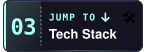</a><!--
  --><a href="#pinned">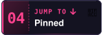</a><!--
  --><a href="#demos"></a>
  <br/>
  <a href="#projects"></a><!--
  --><a href="#achievements"></a><!--
  --><a href="#certifications">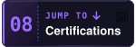</a><!--
  --><a href="#stats">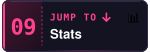</a><!--
  --><a href="#connect"></a>
</p>

<br/>

<!-- ─────────────────────────────── About ─────────────────────────────── -->
<p align="center"><a id="about"></a></p>

I'm **Mukul Prasad**, a pre-final-year **B.E. CSE (AI & ML)** student at **Ramaiah Institute of Technology (MSRIT), Bengaluru** with a **9.32 CGPA**. I build **agentic AI, graph ML and RAG systems**, from research pipeline to full-stack product. Previously a Research Intern at **IEEE Computer Society**, an ML Intern at **FlyRank AI**, and one of **135 mentors selected nationally** for **GirlScript Summer of Code '26**.

- 📝 **Co-author of an IEEE research paper** on the NDPI drug-repurposing framework · built an AI pipeline spanning **1,500+ drugs, 20K+ genes and 50K+ edges**
- 🏆 **National Semifinalist** at Flipkart Grid 8.0 & JPMorgan Chase Code for Good '26 · **Zonal Champion & Finalist**, HackArena 2.0 (IIIT Delhi) · **3× 1st Runner-up** · **SIH 2026 Semifinalist** → [all wins](#achievements)
- 📊 **Kaggle:** Top 150 of 10,760 (Wellbore Geology Prediction) · Top 25 of 348 (F1 Race Result Classification)
- 👥 Community lead for the **MSRIT '28 & '29 student communities** (3.5K+ active members) · Founding Core Member, **AWS Cloud Club**

```python
mukul = {
    "built":    ["NeuroSOC", "Project Astraeus", "RegGraph-AI", "KisaanMitra", "Jvalyx"],
    "focus":    ["Agentic AI", "Multi-Agent Systems", "Graph ML", "RAG", "LLM workflows"],
    "stack":    ["PyTorch", "TensorFlow", "FastAPI", "Next.js", "NestJS", "AWS", "Docker"],
    "reach_me": "mukulprasad958@gmail.com",
}
```

<!-- ───────────────────────────── Experience ──────────────────────────── -->
<p align="center"><a id="experience"></a></p>

<table>
  <tr>
    <td width="32%" valign="top">
      <b>🧑‍🏫 Open Source Mentor</b><br/>
      <sub>GSSoC '26</sub><br/>
      <a href="https://gssoc.girlscript.org/profile/3a54f8f3-154d-4d8c-9997-3c06d47f6e17"><b>GirlScript Summer of Code</b></a><br/>
      <sub>📅 Jun 2026 – Sep 2026</sub><br/>
      
    </td>
    <td valign="top">
      <ul>
        <li>Selected among <b>135 mentors nationally</b>, supporting developers across <b>6 domains</b> — AI/ML, Web, DevOps/Cloud, Data Science, Security and Open Source.</li>
        <li>Guided <b>3 developers</b> across <b>5+ engineering areas</b> (React state management, async workflows, CI automation, debugging, code review) and earned <b>60 mentor points</b>.</li>
      </ul>
      
      
      
    </td>
  </tr>
  <tr>
    <td width="32%" valign="top">
      <b>💼 ML Intern</b><br/>
      <sub>Search Intelligence</sub><br/>
      <b>FlyRank AI</b><br/>
      <sub>📅 Jul 2026 – Aug 2026</sub><br/>
      
    </td>
    <td valign="top">
      <ul>
        <li>Worked on <b>search intelligence, data contracts, action scoring and ML experimentation</b>.</li>
        <li>Built a <b>Google Search Ranking & Discoverability</b> capstone with Python, PyTorch, scikit-learn and LLM workflows.</li>
      </ul>
      
      
      
    </td>
  </tr>
  <tr>
    <td width="32%" valign="top">
      <b>🔬 Research Intern</b><br/>
      <sub>AI/ML · Drug Repurposing</sub><br/>
      <b>IEEE Computer Society</b><br/>
      <sub>📅 Apr 2026 – Jun 2026</sub><br/>
      
    </td>
    <td valign="top">
      <ul>
        <li>Built an AI <b>drug-repurposing pipeline</b> spanning <b>1,500+ drugs, 20K+ genes, 130+ diseases and 50K+ edges</b> with PyTorch Geometric, RDKit, PubMed, WHO data and 2,048-bit Morgan fingerprints.</li>
        <li>Co-author of an <b>IEEE research paper</b> on the 4-component <b>NDPI framework</b> — HGT predictions + chemical similarity + PubMed evidence + WHO equity scoring.</li>
      </ul>
      
      
      
      
    </td>
  </tr>
</table>

<!-- ───────────────────────────── Tech Stack ──────────────────────────── -->
<p align="center"><a id="tech-stack"></a></p>

<table>
  <tr>
    <td width="20%" align="center"><b>💻 Languages</b></td>
    <td>
      <br/>
      
    </td>
  </tr>
  <tr>
    <td align="center"><b>🤖 AI · ML · Data</b></td>
    <td>
      <br/>
      
      
      
      
      
      
      
    </td>
  </tr>
  <tr>
    <td align="center"><b>🧠 LLMs & Agentic AI</b></td>
    <td>
      
      
      
      
      
      
      
      
      
      
      
      
    </td>
  </tr>
  <tr>
    <td align="center"><b>🌐 Web & Backend</b></td>
    <td>
      <br/>
      
      
      
      
    </td>
  </tr>
  <tr>
    <td align="center"><b>☁️ Cloud & MLOps</b></td>
    <td>
      <br/>
      
      
      
      
      
      
      
    </td>
  </tr>
  <tr>
    <td align="center"><b>🗄️ Databases</b></td>
    <td>
      <br/>
      
      
      
    </td>
  </tr>
  <tr>
    <td align="center"><b>🛠️ Tools</b></td>
    <td>
      
    </td>
  </tr>
</table>

<!-- ─────────────────────────── Pinned Highlights ─────────────────────── -->
<p align="center"><a id="pinned"></a></p>

<table>
  <tr>
    <td width="50%" valign="top">
      <a href="https://github.com/MUKUL-PRASAD-SIGH/Project_NeuroSOC">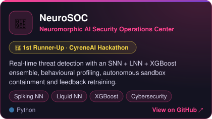</a>
      <p align="center">
        <a href="https://youtu.be/eUf58W-rJoE"></a>
        <a href="https://github.com/MUKUL-PRASAD-SIGH/Project_NeuroSOC"></a>
      </p>
    </td>
    <td width="50%" valign="top">
      <a href="https://github.com/MUKUL-PRASAD-SIGH/Jvalyx">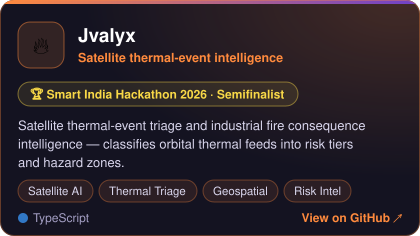</a>
      <p align="center">
        <a href="https://www.youtube.com/watch?v=NJRoPRCKs64"></a>
        <a href="https://github.com/MUKUL-PRASAD-SIGH/Jvalyx"></a>
      </p>
    </td>
  </tr>
  <tr>
    <td width="50%" valign="top">
      <a href="https://github.com/MUKUL-PRASAD-SIGH/PROJECT_ENTANGLEMENT">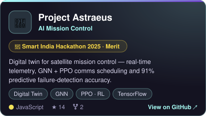</a>
      <p align="center">
        <a href="https://youtu.be/HiNK79Ijav8"></a>
        <a href="https://astraeus-frontend.onrender.com/"></a>
        <a href="https://github.com/MUKUL-PRASAD-SIGH/PROJECT_ENTANGLEMENT"></a>
      </p>
    </td>
    <td width="50%" valign="top">
      <a href="https://github.com/MUKUL-PRASAD-SIGH/RegGraph-AI">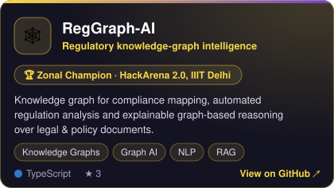</a>
      <p align="center">
        <a href="https://drive.google.com/file/d/1djHr1MN3IEXG5-McdXZwj8YXoBm-ktkx/view?usp=drive_link"></a>
        <a href="https://github.com/MUKUL-PRASAD-SIGH/RegGraph-AI"></a>
      </p>
    </td>
  </tr>
</table>

<!-- ──────────────────────── Demos & Live Deployments ─────────────────── -->
<p align="center"><a id="demos"></a></p>

<h3 align="center">🎬 Demo videos</h3>

<table>
  <tr>
    <td width="33%" align="center" valign="top">
      <a href="https://youtu.be/eUf58W-rJoE"></a><br/>
      <b>🧠 NeuroSOC</b><br/>
      <sub>Neuromorphic AI SOC — SNN + LNN + XGBoost threat detection</sub>
    </td>
    <td width="33%" align="center" valign="top">
      <a href="https://www.youtube.com/watch?v=NJRoPRCKs64"></a><br/>
      <b>🔥 Jvalyx</b><br/>
      <sub>SIH 2026 · satellite thermal-event & industrial fire intelligence</sub>
    </td>
    <td width="33%" align="center" valign="top">
      <a href="https://youtu.be/HiNK79Ijav8"></a><br/>
      <b>🚀 Project Astraeus</b><br/>
      <sub>AI mission control with digital-twin simulation</sub>
    </td>
  </tr>
  <tr>
    <td width="33%" align="center" valign="top">
      <a href="https://youtu.be/Q-XZVE3dy20"></a><br/>
      <b>⏳ Kairos</b><br/>
      <sub>Full-duplex, interruptible real-time voice agent</sub>
    </td>
    <td width="33%" align="center" valign="top">
      <a href="https://www.youtube.com/watch?v=ZB8utg1Q0WM"></a><br/>
      <b>⛏️ MOIL Manganese Copilot</b><br/>
      <sub>SIH 2026 · AI copilot for next-shift recovery decisions</sub>
    </td>
    <td width="33%" align="center" valign="top">
      <a href="https://youtu.be/eOWGswfy5_E"></a><br/>
      <b>⚡ ContextOS</b><br/>
      <sub>Proactive Android agent for contextual workflows</sub>
    </td>
  </tr>
  <tr>
    <td width="33%" align="center" valign="top">
      <a href="https://youtu.be/SxgtEXvsAV4"></a><br/>
      <b>💳 Rebound</b><br/>
      <sub>Razorpay AI Buildathon '26 · autonomous revenue recovery</sub>
    </td>
    <td width="33%" align="center" valign="top">
      <a href="https://youtu.be/S1hz6yakK4Y"></a><br/>
      <b>🌾 KisaanMitra</b><br/>
      <sub>5-agent system for collective agricultural intelligence</sub>
    </td>
    <td width="33%" align="center" valign="top">
      <a href="https://youtu.be/T3-CFJ__JWg"></a><br/>
      <b>❤️ DonorConnect</b><br/>
      <sub>Real-time intelligent blood donor matching</sub>
    </td>
  </tr>
  <tr>
    <td width="33%" align="center" valign="top">
      <a href="https://youtu.be/KBmNAY7ayVg"></a><br/>
      <b>📰 NovaPulse</b><br/>
      <sub>Voice-powered multi-agent news intelligence on Amazon Nova</sub>
    </td>
    <td width="33%" align="center" valign="top">
      <a href="https://youtu.be/o3bw84sPgDA"></a><br/>
      <b>📊 Hackathon Dashboard</b><br/>
      <sub>Real-time hackathon & submission tracking</sub>
    </td>
    <td width="33%" align="center" valign="top">
      <a href="https://youtu.be/AgLqEC7HuPs"></a><br/>
      <b>✂️ ClipBait</b><br/>
      <sub>AI-powered smart clipboard</sub>
    </td>
  </tr>
</table>

<h3 align="center">🌐 Live deployments</h3>

<div align="center">

| | Project | What it does | |
|:-:|:--|:--|:-:|
| 🚔 | **Project Falcon** | AI crime-analytics platform — role-based dashboards, hotspot maps, criminal-network analysis & predictive insights | [**Open&nbsp;app&nbsp;↗**](https://auth-60079106947.development.catalystserverless.in/app/index.html#/login) |
| 🚀 | **Project Astraeus** | AI mission control with digital-twin simulation, real-time monitoring & decision support | [**Open&nbsp;app&nbsp;↗**](https://astraeus-frontend.onrender.com/) |
| ❤️ | **DonorConnect** | Intelligent geospatial blood-donor matching with real-time emergency alerts | [**Open&nbsp;app&nbsp;↗**](https://bloodme-frontend.vercel.app/) |
| 📰 | **Amazon Nova Pulse** | Voice-powered multi-agent news intelligence using Amazon Nova | [**Open&nbsp;app&nbsp;↗**](https://nova-pulse-gilt.vercel.app/) |
| 📊 | **Hackathon Dashboard** | Real-time hackathon tracking, participant analytics & event management | [**Open&nbsp;app&nbsp;↗**](https://hackersboard.netlify.app/) |
| 🌐 | **Portfolio** | My personal site — projects, research & experience | [**Visit ↗**](https://mukulprasad.netlify.app/) |

<sub>Free-tier hosts can take a few seconds to wake up on the first visit.</sub>

</div>

<!-- ───────────────────────────── All Projects ────────────────────────── -->
<p align="center"><a id="projects"></a></p>

| Project | Category | What it is |
| :-- | :-: | :-- |
| [**NeuroSOC** 🧠](https://github.com/MUKUL-PRASAD-SIGH/Project_NeuroSOC) |  | 🥈 *CyreneAI Hackathon — 1st Runner-Up.* Neuromorphic AI SOC analyst: real-time threat detection with SNN, LNN and XGBoost ensembles, behavioural profiling, sandbox isolation and feedback retraining. |
| [**RegGraph-AI** 🕸️](https://github.com/MUKUL-PRASAD-SIGH/RegGraph-AI) |  | 🏆 *HackArena 2.0 (IIIT Delhi) — Zonal Champion & Finalist.* Graph-AI pipeline for regulatory intelligence — knowledge graphs, NLP entity extraction and RAG for explainable compliance retrieval that surfaces regulatory risk pathways. |
| [**Project Astraeus** 🚀](https://github.com/MUKUL-PRASAD-SIGH/PROJECT_ENTANGLEMENT) |  | 🏅 *SIH 2025 — Merit.* AI-powered digital twin for satellite mission control: real-time telemetry, GNN + PPO communication scheduling and 91% predictive failure-detection accuracy. |
| [**Jvalyx** 🔥](https://github.com/MUKUL-PRASAD-SIGH/Jvalyx) |  | 🏆 *SIH 2026 — Semifinalist.* Space-based industrial fire classification and consequence intelligence, triaging satellite thermal feeds to assess hazard zones and cascading risks. |
| [**MOIL Manganese Copilot** ⛏️](https://github.com/MUKUL-PRASAD-SIGH/manganese) |  | 🏆 *SIH 2026 — Semifinalist (PS 26009).* AI decision copilot for MOIL mining operations, turning mine signals and sensor telemetry into next-shift recovery decisions and yield intelligence. |
| [**KisaanMitra** 🌾](https://github.com/MUKUL-PRASAD-SIGH/KisaanMitra) |  | 🥈 *Agentic AI Hackathon — 1st Runner-up.* 5-agent system for crop advisory, market intelligence, weather monitoring, IoT integration and alerting — trained on 12K+ agricultural records with 87% accuracy and sub-2 s inference. |
| [**DonorConnect** ❤️](https://github.com/MUKUL-PRASAD-SIGH/DonorConnectT) |  | 🔟 *BIT Mesra Hack '24 — Top 10 / 1,000 teams.* Full-stack blood-donation platform with geospatial donor matching, 3-channel emergency notifications, real-time WebSocket updates and JWT auth (NestJS · Next.js · MongoDB · Socket.IO · Docker). |
| [**Project Falcon** 🦅](https://github.com/MUKUL-PRASAD-SIGH/Project-Falcon) |  | AI public-safety intelligence platform — explainable RAG, geospatial crime-hotspot detection, criminal-network analysis, predictive analytics, anomaly detection and multilingual assistants. |
| [**Kairos** ⏳](https://github.com/MUKUL-PRASAD-SIGH/Samsung) |  | Full-duplex, interruptible real-time voice agent built for a Samsung hackathon — barge-in turn-taking, mid-task corrections and adaptive execution. |
| [**Project TCS** 🏛️](https://github.com/MUKUL-PRASAD-SIGH/Project_TCS) |  | 🎖️ *TCS Hackathon — Consolation Prize.* Gemini-powered conversational assistant for municipal permit eligibility, reasoning across civic regulations and licensing bylaws. |
| [**Rebound** 💳](https://github.com/MUKUL-PRASAD-SIGH/Rebound) |  | *Razorpay AI Buildathon 2026.* Autonomous AI revenue-recovery engine orchestrating intelligent payment-retry routing and churn mitigation. |
| [**ContextOS** ⚡](https://github.com/MUKUL-PRASAD-SIGH/ContextOS) |  | Proactive Android background agent that automates meetings, navigation, DND, reminders and contextual workflows with on-device AI, memory and Google API integrations. |
| [**GitHopper** 🦘](https://github.com/MUKUL-PRASAD-SIGH/GITHOPPER) |  | Git repository analysis platform — deep code scanning, technical-debt detection, health scoring and real-time monitoring with MCP and AI-powered synthesis. |
| [**LLM Benchmark Game** 🎮](https://github.com/MUKUL-PRASAD-SIGH/LLM_BENCHMARK_GAME) |  | Interactive platform that compares LLMs through real-time game challenges and reasoning tasks to evaluate intelligence, speed and accuracy. |
| [**NovaPulse** 📰](https://github.com/MUKUL-PRASAD-SIGH/NovaPulse) |  | Voice-powered multi-agent news intelligence on Amazon Nova — sentiment analysis, trend detection and automated executive summaries. |
| [**Hackathon Dashboard** 📊](https://github.com/MUKUL-PRASAD-SIGH/Hackathon-Dashboard) |  | Real-time hackathon management dashboard for event tracking, analytics and participant intelligence. |
| [**ClipBait** ✂️](https://github.com/MUKUL-PRASAD-SIGH/Clipbait) |  | AI-powered smart clipboard that captures, analyses and understands copied content using ML & DL. |
| [**VAAYA** ✈️](https://github.com/MUKUL-PRASAD-SIGH/VAAYA-PROJECT) |  | Smart travel platform blending Google Maps, reels-style discovery and gamified exploration quests for travellers and local earners. |
| [**VoOTEX** 🎙️](https://github.com/MUKUL-PRASAD-SIGH/VoOTEX) |  | Voice-to-text transcription pipeline with speaker diarization, noise handling and post-processing intelligence. |
| [**X-FORECAST** 📈](https://github.com/MUKUL-PRASAD-SIGH/X-FORECAST) |  | Time-series forecasting models and dashboards for demand prediction, analytics and trend intelligence. |
| [**GlamGlow** ✨](https://github.com/MUKUL-PRASAD-SIGH/GlamGlow) |  | ML-powered beauty-product recommendation engine for personalised skincare discovery. |

<!-- ─────────────────────── Hackathons & Achievements ─────────────────── -->
<p align="center"><a id="achievements"></a></p>

<p align="center">
  
  
  
  
</p>

| 🏆 Competition | 🧩 Project | 🥇 Result |
| :-- | :-- | :-- |
| **Flipkart Grid 8.0** | — | 🏅 **National Semifinalist** |
| **JPMorgan Chase — Code for Good '26** | — | 🏅 **National Semifinalist** |
| **HackArena 2.0 · IIIT Delhi** | [RegGraph-AI](https://github.com/MUKUL-PRASAD-SIGH/RegGraph-AI) | 🏆 **Zonal Champion** · Finalist |
| **GenAI Fusion '25 Hack** | — | 🥈 **1st Runner-up** |
| **Agentic AI Hackathon** | [KisaanMitra](https://github.com/MUKUL-PRASAD-SIGH/KisaanMitra) | 🥈 **1st Runner-up** |
| **CyreneAI Hackathon** | [NeuroSOC](https://github.com/MUKUL-PRASAD-SIGH/Project_NeuroSOC) | 🥈 **1st Runner-up** |
| **Smart India Hackathon 2026** | [MOIL Manganese Copilot](https://github.com/MUKUL-PRASAD-SIGH/manganese) · [Jvalyx](https://github.com/MUKUL-PRASAD-SIGH/Jvalyx) | 🏆 **Semifinalist** |
| **Smart India Hackathon 2025** | [Project Astraeus](https://github.com/MUKUL-PRASAD-SIGH/PROJECT_ENTANGLEMENT) | 🏅 **Merit** |
| **BIT Mesra Hack '24 · ECE Society** | [DonorConnect](https://github.com/MUKUL-PRASAD-SIGH/DonorConnectT) | 🔟 **Top 10 / 1,000 teams** |
| **TCS Hackathon** | [Project TCS](https://github.com/MUKUL-PRASAD-SIGH/Project_TCS) | 🎖️ **Consolation Prize** |
| **Hack-A-War '25** | — | **Top 10** · Finalist |
| **Samsung PRISM '25 & '26** | — | **Finalist** |
| **wHACKiest '26 · Codecrafter '26 · HackMalenadu '26** | — | **Finalist** |
| **Kaggle — Wellbore Geology Prediction** <br/><sub>international team led by PyJa</sub> | [Solution](https://github.com/MUKUL-PRASAD-SIGH/KAGGLE-Wellbore_Geology_Prediction) | 📈 **Top 150 / 10,760 entrants** <sub>(Jul 2026)</sub> |
| **Kaggle — F1 Race Result Classification** <br/><sub>Polaris Institute of Technology</sub> | [Solution](https://github.com/MUKUL-PRASAD-SIGH/KAGGLE-F1-race-result-classification) | 📈 **Top 25 / 348 entrants** |
| **Flipkart Gridlock Hackathon 2.0** | [Travel-demand ML](https://www.hackerearth.com/challenges/competitive/gridlock-hackathon-20/problems/) | Travel-pattern, booking & cancellation insights for demand prediction <sub>(77,299 × 11 dataset)</sub> |

<!-- ───────────────────── Certifications & Leadership ─────────────────── -->
<p align="center"><a id="certifications"></a></p>

<table>
  <tr>
    <th width="50%">📜 Certifications</th>
    <th width="50%">🌟 Leadership & Community</th>
  </tr>
  <tr>
    <td valign="top">
      <ul>
        <li><b>AWS Cloud Practitioner Essentials</b> — Amazon Web Services</li>
        <li><b>AWS Fundamentals of AI / ML</b> — Amazon Web Services</li>
        <li><b>India Impact GenAI Program</b> — IBM × IISc Bengaluru</li>
        <li><b>AI Fluency: Framework & Foundations</b> — Anthropic</li>
      </ul>
    </td>
    <td valign="top">
      <ul>
        <li>👥 Leading the <b>MSRIT '28 & '29</b> student communities — <b>3.5K+ active members</b></li>
        <li>☁️ <b>Founding Core Member</b> — AWS Cloud Club</li>
        <li>⚛️ <b>Core Member</b> — Quantum Cluster (QpiAI industry MoU)</li>
        <li>🌐 <b>Webmaster</b> — IEEE CIS</li>
        <li>🧑‍💻 <b>Hack Organizer</b> — DeepStation (US) × Google for Developers</li>
        <li>🚀 Member — E-Cell · DSC (formerly GDG)</li>
      </ul>
    </td>
  </tr>
</table>

<!-- ──────────────────────────── GitHub Stats ─────────────────────────── -->
<p align="center"><a id="stats"></a></p>

<p align="center">
  
  
</p>

<p align="center">
  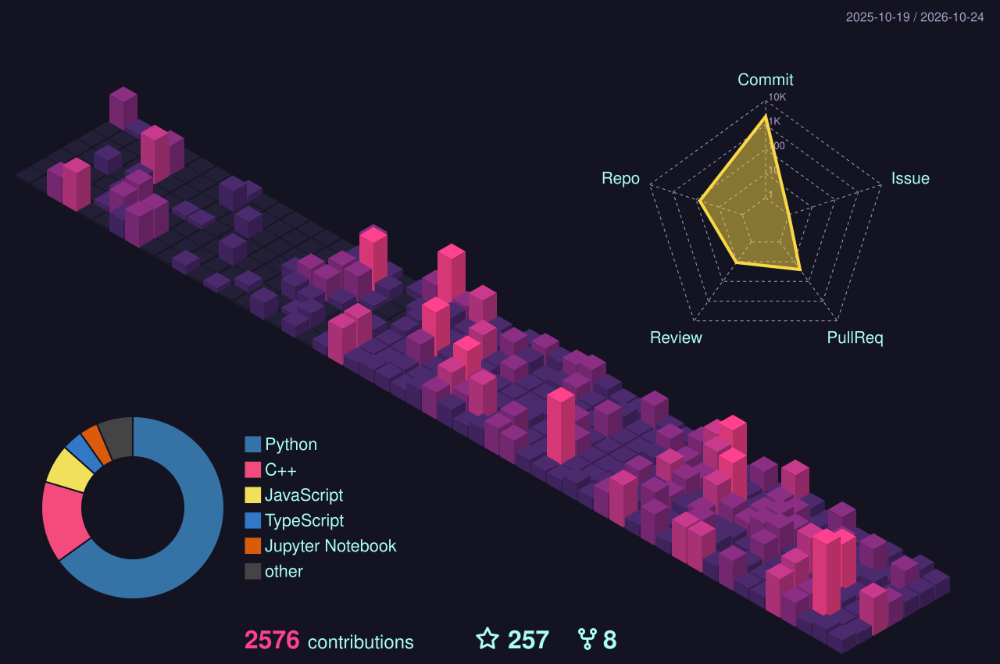
</p>

<p align="center">
  
  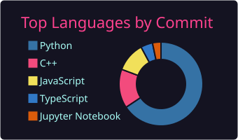
  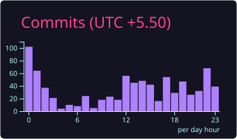
</p>

<p align="center">
  
</p>

<p align="center">
  
</p>

<p align="center">
  <picture>
    <source media="(prefers-color-scheme: dark)" srcset="assets/snake-dark.svg"/>
    
  </picture>
</p>

<!-- ─────────────────────────── Let's Connect ─────────────────────────── -->
<p align="center"><a id="connect"></a></p>

<p align="center">
  <a href="https://www.linkedin.com/in/mukulprasad1"></a>
  <a href="mailto:mukulprasad958@gmail.com"></a>
  <br/>
  <a href="https://mukulprasad.netlify.app"></a>
  <a href="https://mukul.taplink.in"></a>
  <br/>
  <a href="https://codolio.com/profile/mukulprasad/devStats/github"></a>
  <a href="https://instagram.com/mukul_prasad_2030"></a>
  <a href="https://mukul-prasad-sigh.github.io/MyResume/RESUME.pdf"></a>
</p>

<p align="center">
  <i>"Discovery consists of seeing what everybody has seen and thinking what nobody has thought."</i><br/>
  <sub>— Albert Szent-Györgyi</sub>
</p>

<p align="center"><b>Thanks for stopping by! Feel free to explore my repositories or reach out for a collaboration. 🚀</b></p>

<p align="center"><a href="#top"></a></p>

<!-- PULSE:START -->
<p align="center"><sub>🤖 Auto-synced every 6 hours by GitHub Actions · last refreshed <code>2026-10-23 20:45 UTC</code> (Friday) · run #1212</sub></p>
<!-- PULSE:END -->
